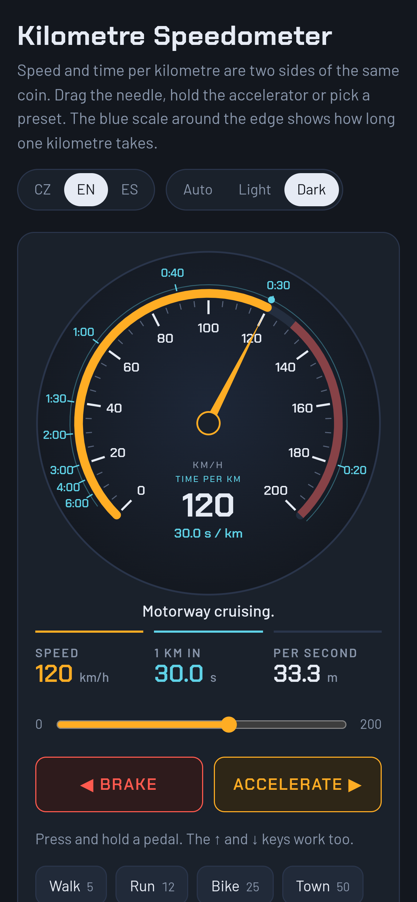
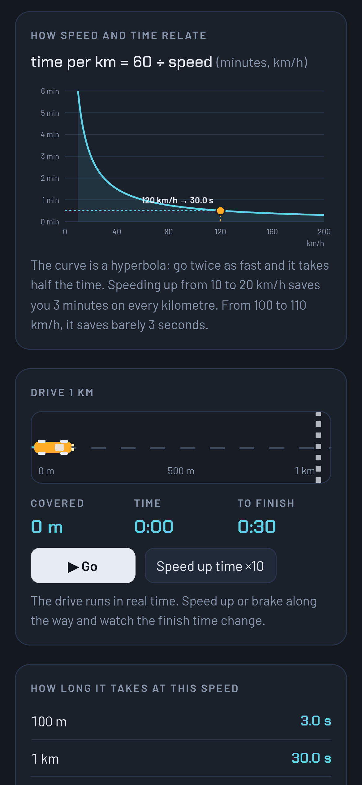
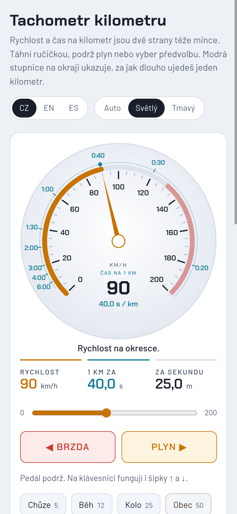

# Tachometr kilometru · Kilometre Speedometer · Velocímetro del kilómetro

Interaktivní tachometr, který ke každé rychlosti ukazuje, za jak dlouho ujedeš 1 km.
Obsahuje graf vztahu rychlost–čas, simulaci jízdy na 1 km a tabulku časů pro různé vzdálenosti.

Pointa: `čas = 60 / rychlost` je hyperbola. Zrychlení z 10 na 20 km/h ušetří na každém
kilometru tři minuty, zrychlení ze 100 na 110 km/h tři sekundy.

<p>
  
  
  
</p>

- Jazyky: čeština, angličtina, španělština – včetně místních rychlostních limitů a tras
- Vzhled: světlý, tmavý, automatický
- Funguje bez připojení a nenačítá nic z cizích serverů
- Bez instalace: stačí otevřít `index.html`

## Spuštění

```bash
python3 -m http.server 8000   # pak http://localhost:8000
npm test                      # kontroly bez prohlížeče
```

Web nemá build ani žádnou závislost. Node a Capacitor v repozitáři jsou jen kvůli APK.

## Android

Tentýž web zabalený do WebView. APK sestavuje GitHub Actions na tagu `v*`,
podrobnosti v [docs/android.md](docs/android.md).

## Dokumentace

| | |
|---|---|
| [docs/architektura.md](docs/architektura.md) | jak je to poskládané a kde co hledat |
| [docs/vyvoj.md](docs/vyvoj.md) | spuštění, kontroly, přidání jazyka, barvy, ikony |
| [docs/android.md](docs/android.md) | sestavení APK, podepsání, vydání |
| [docs/zapstore.md](docs/zapstore.md) | zveřejnění v Zapstore |

Pravidla pro úpravy (i pro Claude Code) jsou v [CLAUDE.md](CLAUDE.md).

## Licence

MIT, viz [LICENSE](LICENSE).
